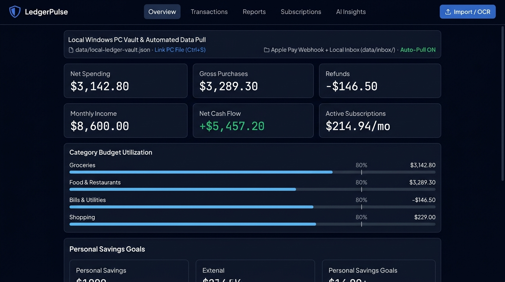
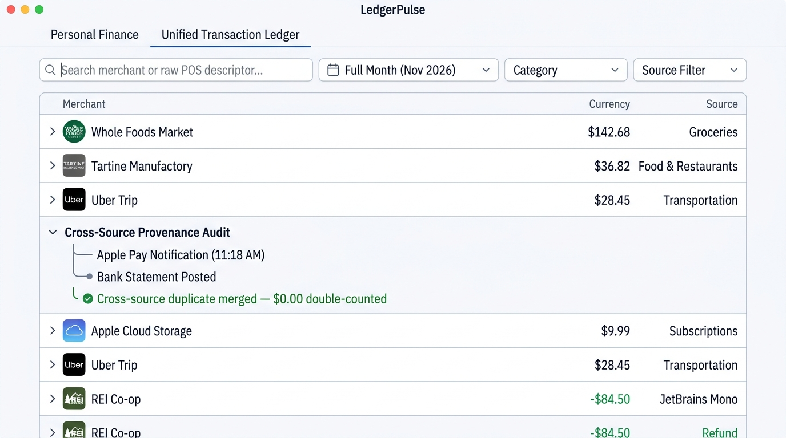
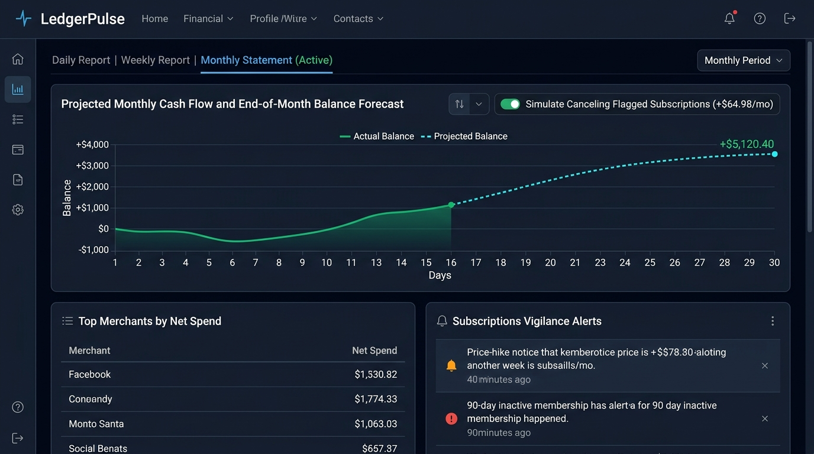
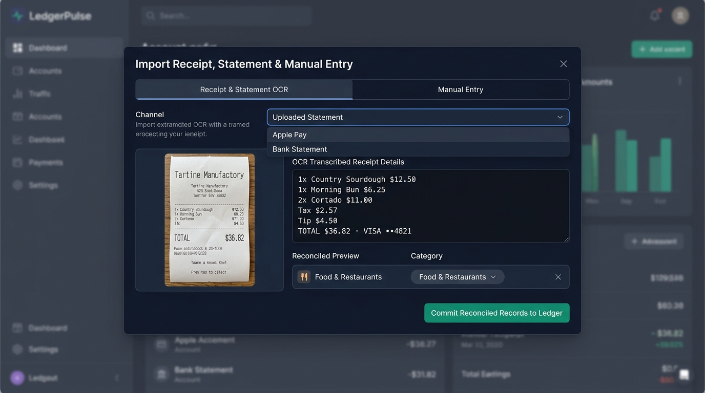

# LedgerPulse — Personal Finance, Split Bills & Multi-Device Ledger

**Repository:** [https://github.com/MakawanP/LedgerPulse](https://github.com/MakawanP/LedgerPulse)

**LedgerPulse** is a full-stack personal finance, bill-splitting, and spending intelligence application built for **Windows 10/11 Desktop, macOS, and Mobile**. It combines **local-first PC storage** (`data/local-ledger-vault.json` + native `Ctrl+S` file linking) with optional **real-time multi-device Cloud Sync** (Firebase Auth & Firestore with offline persistence) and **in-app Gmail receipt scanning**, while enforcing strict accounting guardrails so shared bills, refunds, transfers, and cross-channel duplicates never distort your true personal spend.

---

## UI Demo & Screenshots

### 1. Executive Overview & Category Budget Distribution
> Clean executive 8-metric summary, split-segment category budget progress bars (green on track, amber at 80%, red split overage above 100%), and integrated spending insights.



### 2. Unified Transaction Ledger & Monthly Cash Flow Forecast

| Unified Transaction Ledger & Provenance Audit (Light Mode) | Projected Cash Flow & Subscription Watchdog |
| :---: | :---: |
|  |  |
| *Searchable ledger with automated merchant logos, bill-split badges, and expandable cross-source duplicate verification (`$0.00` double-counted).* | *Interactive end-of-month balance trajectory paired with subscription price-hike and >3-month inactivity alerts.* |

### 3. Multimodal Receipt & PDF Statement OCR
> Drag-and-drop receipt photos or PDF bank statements (or capture from your phone camera / paste via `Ctrl+V`) to extract line items, tax, tip, and exact total charged before reconciling against existing ledger entries.



---

## Streamlined 5-Tab Workspace Architecture

LedgerPulse organizes every workflow in a focused 5-tab navigation order across desktop (`>=1024px` top bar, `768px–1023px` tablet strip) and mobile (`Overview`, `Tx & Subs`, `Reports`, `Goals`, `Splits`):

1. **Overview**: High-signal executive summary combining the 8-metric running KPI grid, conditional uncertain-category review queue, monthly category budget bars, and **Spending Insights & Live Ledger Audit** (all 6 diagnostic pillars + interactive natural-language ledger Q&A)—kept free of duplicate tables or subscription alert clutter.
2. **Transactions & Subscriptions (`Tx & Subs` on Mobile)**: Unites the searchable, multi-facet filterable **Transaction Ledger** (merchant logos, inline category/status editing, per-row bill splitting, provenance audit drawers, bulk delete, and undo) with **Recurring Subscriptions & Bills** and the **Automated Subscription Watchdog — Price Increases & >3-Month Inactivity Alerts**. Includes a segmented subview switcher (`Combined View`, `Transactions`, `Subscriptions & Watchdog`) and 1-click subscription cancellation that redirects saved monthly spend directly into a chosen Savings Goal.
3. **Reports**: Daily itemized logs, Weekly 7-day category & top-purchase breakdowns, and Monthly executive statements with an interactive SVG **Projected Monthly Cash Flow & End-of-Month Balance Forecast** chart.
4. **Savings Goals (`Goals` on Mobile)**: Dedicated **Personal Savings Goals & Automated Monthly Allocations** view with **directly editable Total Saved balances** (both via the top `Total Saved Across Goals` KPI card and inline per goal alongside Target and Monthly Contribution), quick `+$100` / `+$250` deposits, and **1-click Undo Delete** (in both the inline Savings Goals banner and notification bar) that restores deleted goals locally and in Cloud Firestore.
5. **Split Bills (`Splits` on Mobile)**: Dedicated **Split Bills & Friend Reimbursements Tracker**. When you cover a shared tab (for example, paying **$20.00** at a coffee shop where **$10.00** is a friend's drink), only your **$10.00** personal share counts toward monthly spending and category budgets while your friend's **$10.00** is tracked under open balances until marked paid back.

---

## Windows 10 / 11 Desktop Release & Packaging

LedgerPulse ships with a zero-console Windows 10/11 desktop app packager (`npm run release:windows`) and an automated GitHub Actions release workflow:

### Option A — Download Directly from the App or GitHub Releases
1. Click **Windows Release (.zip)** in the app's **Sync & Gmail** panel (or footer), or download `LedgerPulse-Windows-v1.0.0.zip` / `LedgerPulse-Windows-Standalone-x64.zip` from **[GitHub Releases](https://github.com/MakawanP/LedgerPulse/releases)**.
2. Extract the `.zip` folder anywhere on your Windows 10 or Windows 11 PC (for example `C:\Apps\LedgerPulse`).
3. Double-click **`Install-Windows-App.bat`** once to create **Desktop** and **Start Menu** shortcuts with the custom `ledgerpulse.ico` icon.
4. Launch **LedgerPulse** from your Desktop or Start Menu (`LedgerPulse.vbs`)—starts the local vault server silently in the background with **no black Command Prompt window** and opens LedgerPulse in standalone Edge/Chrome `--app` mode. Use `Stop-LedgerPulse-Server.bat` anytime to stop the background server.

### Option B — Build the Windows Release Package Locally
```bash
npm run release:windows
```
Generates:
- `public/ledgerpulse.ico` — Native Windows multi-header icon
- `release/LedgerPulse-Windows/` — Bundled `dist/` client + standalone `server.cjs` + `LedgerPulse.vbs` + `Install-Windows-App.bat` + `Stop-LedgerPulse-Server.bat`
- `release/LedgerPulse-Windows-v1.0.0.zip` — Distributable Windows release archive (also served at `GET /api/release/windows.zip`)

### Option C — Automated GitHub Releases (`.github/workflows/release-windows.yml`)
Push a version tag (e.g. `git tag v1.0.0 && git push origin v1.0.0`) or trigger the **Release Windows Desktop Package** workflow manually in GitHub Actions to build and publish both:
- **`LedgerPulse-Windows-Portable-v*.zip`** (lightweight package using system Node.js)
- **`LedgerPulse-Windows-Standalone-x64-v*.zip`** (self-contained zero-prerequisite bundle with `runtime\node.exe` embedded)

---

## Core Capabilities & Features

### 1. Split Bills & Friend Reimbursements
- **True Personal Spend Accounting**: Split any existing purchase from the ledger or log a split purchase directly from the **Split Bills** tab or floating **Quick Add (`+`)** menu.
- **Multi-Friend & 50/50 Presets**: Assign exact dollar amounts or 50/50 splits across one or multiple friends with optional item notes (e.g., `"Friend's drink"`).
- **Reimbursement Lifecycle**: Filter by `All Splits`, `Unpaid`, or `Paid Back`, search by friend or merchant, settle individual shares (`Mark Paid` / `Mark Unpaid`), or batch-settle all open shares for a friend in one click.

### 2. Editable Savings Goals & Instant Undo Delete
- **Editable Saved Balances**: Click any goal's saved dollar amount, click `Edit Saved / Target / Monthly`, or click `Edit` on the **Total Saved Across Goals** KPI card to adjust saved balances directly.
- **Undo Deleted Goals**: Deleting a savings goal surfaces an immediate **Undo Delete** button both inside the Savings Goals header banner and in the top notification bar, restoring the goal and re-syncing to Firestore in one click.

### 3. Real-Time Phone & Computer Sync + In-App Gmail Connection
- **Collapsible Sync & Gmail Hub**: Sign in with Google inside the app to enable live Firestore synchronization across your phone and computer (backed by IndexedDB offline caching so edits work offline and sync automatically on reconnect).
- **Read-Only Gmail Receipt Scanner**: Connect Gmail (`gmail.readonly`) in-app to scan recent order confirmations, ride receipts, and billing notices directly in the browser and reconcile them against your ledger without server-side credential storage.
- **Starter Demo & Channel Presets**: Starts with a clean ledger; load the **Starter Demo** (including sample split bills, subscriptions, budgets, and goals) or individual channel import packs anytime, and delete rows or reset the ledger in one click.

### 4. Split-Segment Category Budgets & 16 Standardized Categories
- **Three-State Visual Progress Bars**:
  - **Green (`<80%`)**: On track within monthly budget.
  - **Amber (`80%–99%`)**: Approaching monthly category limit (with an 80% threshold tick).
  - **Red Split Bar (`100%+`)**: Displays the base budget limit alongside a distinct crimson overage segment showing exact dollar overrun.
- **16 Standardized Categories**: `Food & Restaurants`, `Coffee & Drinks`, `Groceries`, `Shopping & Retail`, `Transportation / Uber / Taxi`, `Gas & Parking`, `Bills & Utilities`, `Rent & Housing`, `Travel & Hotels`, `Entertainment`, `Health & Fitness`, `Subscriptions`, `Personal Care`, `Shopping Online`, `Education`, and `Other / Uncategorized`.

### 5. Cross-Source Deduplication & Local PC Vault
- **Zero Double-Counting**: Merges duplicate captures of the same purchase across Gmail receipts, Apple Pay notifications, and posted card statements into a single verified entry with an expandable **Cross-Source Provenance Audit** drawer.
- **Three-Tier Local Persistence**: Native File System linking (`Ctrl+S` / `Ctrl+O`), automatic disk vault persistence (`data/local-ledger-vault.json`), and installable offline-ready PWA caching.

---

## Tech Stack

- **Frontend**: React 19, TypeScript, Tailwind CSS v4 (dual Light/Dark theme with `@custom-variant dark`), Lucide Icons, Vite, `vite-plugin-pwa`
- **Cloud & Auth**: Firebase Authentication (Google Sign-In + Gmail OAuth token flow) & Cloud Firestore (hardened `firestore.rules` + offline IndexedDB persistence)
- **Backend & Windows Packaging**: Node.js, Express (`server.ts`), `esbuild` standalone CJS bundler (`scripts/build-windows-release.mjs`), Windows WScript/Batch desktop launchers

---

## Project Structure

```text
├── start-windows-app.bat               # Root Windows 10/11 launcher (Standalone / Portable / Dev)
├── windows/                            # Windows 10/11 desktop launcher & shortcut scripts
│   ├── LedgerPulse.vbs                 # Silent zero-console Windows desktop app launcher
│   ├── Install-Windows-App.bat         # Creates Desktop & Start Menu shortcuts with ledgerpulse.ico
│   └── Stop-LedgerPulse-Server.bat     # Stops background LedgerPulse local vault server
├── scripts/
│   └── build-windows-release.mjs       # Builds dist/, server.cjs, ledgerpulse.ico & Windows .zip
├── .github/workflows/
│   └── release-windows.yml             # Publishes Portable & Standalone x64 ZIPs to GitHub Releases
├── index.html                          # Entry HTML + pre-paint dark/light theme initialization
├── server.ts                           # Express API + local disk vault + Windows release ZIP endpoint
├── vite.config.ts                      # Vite + Tailwind v4 + PWA service worker & manifest config
├── firebase-blueprint.json             # Firestore schema blueprint & entity validation constraints
├── firestore.rules                     # Hardened owner-scoped Firestore security rules
├── package.json                        # Scripts (dev, build, lint, release:windows) & dependencies
└── src/
    ├── App.tsx                         # 5-tab workspace, real-time cloud sync & local vault state
    ├── components/
    │   ├── RunningSummaryGrid.tsx      # 8-metric executive summary with quick navigation
    │   ├── CategoryBudgetDistribution.tsx # Split-segment budget bars & Over-Budget/Highest Spend toggle
    │   ├── SpendingInsightsView.tsx    # Integrated Overview insights, 6 diagnostic pillars & live Q&A
    │   ├── TransactionLedgerTable.tsx  # Searchable ledger, inline split badges & provenance drawer
    │   ├── SubscriptionsTracker.tsx    # Recurring bills table + exclusive Subscription Watchdog
    │   ├── SubscriptionAlertsPanel.tsx # Price increase & >3-month inactivity watchdog alerts
    │   ├── FinancialReportsSection.tsx # Daily, Weekly & Monthly statements + Cash Flow Forecast
    │   ├── SavingsGoalsSection.tsx     # Editable Total Saved balances, allocations & Undo Delete
    │   ├── SplitBillsSummaryPanel.tsx  # Dedicated Split Bills & Friend Reimbursements tracker
    │   ├── WindowsVaultAndSyncPanel.tsx # Cloud Sync, Gmail, Apple Pay, Local Vault & Windows .zip
    │   └── MobileBottomNav.tsx         # 5-tab mobile nav (Overview / Tx & Subs / Reports / Goals / Splits)
    └── services/firebaseAndGmail.ts    # Firebase Auth, real-time Firestore sync & Gmail API scanner
```

---

## Getting Started Locally

```bash
# 1. Clone and install dependencies
git clone https://github.com/MakawanP/LedgerPulse.git
cd LedgerPulse
npm install

# 2. Configure optional environment variables
cp .env.example .env

# 3. Start development server on http://localhost:3000
npm run dev

# 4. Build standalone Windows 10/11 release package (.zip)
npm run release:windows
```

---

## Server API Endpoints

| Method | Endpoint | Description |
| :--- | :--- | :--- |
| `GET` | `/api/release/windows.zip` | Downloads the packaged Windows 10/11 desktop release (`LedgerPulse-Windows-v1.0.0.zip`) |
| `GET` | `/api/local-vault` | Reads the persisted local ledger vault (`data/local-ledger-vault.json`) from disk |
| `POST` | `/api/local-vault` | Saves transactions, split shares, budgets, subscriptions, and goals to disk |
| `GET` | `/api/auto-pull/status` | Returns pending counts for queued Apple Pay notifications and `data/inbox/` files |
| `POST` | `/api/auto-pull/sync` | Processes queued Apple Pay alerts + `data/inbox/` receipts/CSVs/PDFs |
| `POST` | `/api/apple-pay/webhook` | Webhook endpoint for incoming Apple Pay / card transaction notifications |
| `POST` | `/api/finance/parse-source` | Multimodal receipt image, PDF invoice, and statement parser |
| `POST` | `/api/finance/audit-insights` | Grounded spending audit and natural-language Q&A over verified ledger figures |
| `GET` | `/api/merchant-logo?domain=...` | Cached merchant favicon/logo resolver with multi-provider fallback |
